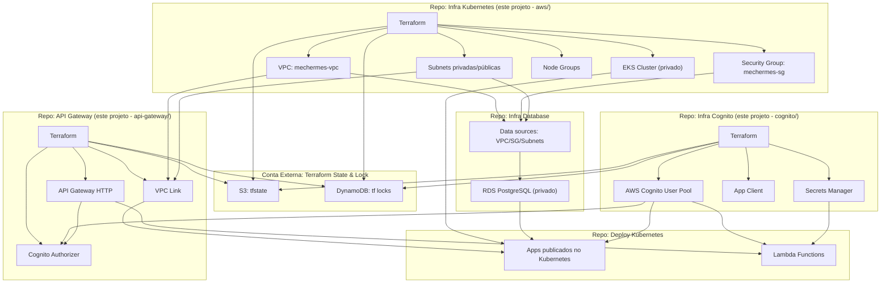

# Mecânica Hermes - Infra Kubernetes

Este repositório é responsável por criar o cluster para realizar o deploy do projeto.

---

## Tecnologias Utilizadas

---


- **Terraform** para provisionamento de infraestrutura como código (IaC)
- **AWS** como provedor de nuvem
- **VPC, Subnets e Security Groups** para rede e segurança
- **Amazon EKS** para o cluster Kubernetes
- **S3** para armazenamento do estado do Terraform
- **DynamoDB** para lock de estado do Terraform
- **Cognito** para provisionar a infraestrutura de autenticação OAuth2 para a aplicação
- **API Gateway** como ponto de entrada unificado com autenticação Cognito e integração com Lambda e API backend
- **GitHub Actions** para execução da pipeline.

---

## Arquitetura dos Projetos de Infra

Nossa infraestrutura para disponibilizar um ambiente completo e funcional é composta por cinco passos sequenciais que são executados em diferentes repositórios:

1. Mecânica Hermes - Infra Kubernetes (Este projeto - módulo `aws/`)
2. Mecânica Hermes - Infra Cognito (Este projeto - módulo `cognito/`)
3. [Mecânica Hermes - Infra Database](https://github.com/fiap-challenge-13soat/mecanica-hermes-db)
4. [Mecânica Hermes - Deploy Kubernetes](https://github.com/fiap-challenge-13soat/mecanica-hermes-k8s)
5. Mecânica Hermes - API Gateway (Este projeto - módulo `api-gateway/`)

---



## Execução pela Pipeline

**Configure as Secrets abaixo no repositório.**

---

| Variável              | Descrição                                                              |
| --------------------- | ---------------------------------------------------------------------- |
| AWS_ACCESS_KEY_ID     | Chave de acesso da AWS.                                                |
| AWS_SECRET_ACCESS_KEY | Chave secreta da AWS.                                                  |
| AWS_SESSION_TOKEN     | Token de sessão da AWS.                                                |
| AWS_DEFAULT_REGION    | Região padrão da AWS (configurada como variável de ambiente).          |
| AWS_ACCOUNT_ID        | ID numérico da conta AWS, usado para montar os ARNs das roles do EKS.  |

**Secrets adicionais para Cognito (configurar nos environments `cognito-hml` e `cognito-prd`):**

| Variável (HML)                     | Variável (PRD)                     | Descrição                                    |
| ---------------------------------- | ---------------------------------- | -------------------------------------------- |
| HML_USER_POOL_ID                   | PRD_USER_POOL_ID                   | ID do User Pool do Cognito                   |
| HML_RESOURCE_SERVER_IDENTIFIER     | PRD_RESOURCE_SERVER_IDENTIFIER     | Identificador do Resource Server             |
| HML_CLIENT_ID                      | PRD_CLIENT_ID                      | ID do App Client do Cognito                  |
| HML_DOMAIN_PREFIX                  | PRD_DOMAIN_PREFIX                  | Prefixo do domínio Cognito                   |

---

Para gerar nova Key e Token use o comando:

```bash
aws sts get-session-token
```

---

### Create Environment

---
Dispare a Action Trigger manual de acordo com o seu ambiente:

**Infraestrutura Base (EKS/VPC):**

- **Learning Lab:** `Learning Lab - Terraform Create`.
- **AWS com Usuário Admin:** `AWS Admin - Terraform Create`.

**Cognito (Autenticação):**

- **HML:** `Cognito HML - Terraform Create`.
- **PRD:** `Cognito PRD - Terraform Create`.

**API Gateway (Ponto de Entrada Unificado):**

- **HML:** `API Gateway HML - Terraform Create`.
- **PRD:** `API Gateway PRD - Terraform Create`.

---

### Destroy Environment

---
Dispare a Action Trigger manual de acordo com o seu ambiente:

**API Gateway (Ponto de Entrada Unificado):**

- **HML:** `API Gateway HML - Terraform Destroy`.
- **PRD:** `API Gateway PRD - Terraform Destroy`.

**Cognito (Autenticação):**

- **HML:** `Cognito HML - Terraform Destroy`.
- **PRD:** `Cognito PRD - Terraform Destroy`.

**Infraestrutura Base (EKS/VPC):**

- **Learning Lab:** `Learning Lab - Terraform Destroy`.
- **AWS com Usuário Admin:** `AWS Admin - Terraform Destroy`.

---

> **Atenção!**
>
> Caso tenha sido realizado o deploy do ambiente K8s, então será necessário realizar o destroy K8s antes de destruir o ambiente via Terraform, caso contrário, alguns recursos de Load Balance e Security Groups impedirão a destruição via Terraform.
---

## Execução Local

Abordaremos os passos para realizar a criação de infraestrutura em ambiente AWS partindo do seu computador.

---

### Configuração da AWS

Realize o comando abaixo e forneça suas credenciais.

```bash
aws configure
```

---

### Criação do bucket para o terraform state

Caso ainda não exista, crie o bucket destinado a armazenar o arquivo do terraform state.

```bash
aws s3api create-bucket --bucket mechermes-tf-state-aws --region us-east-1
```

---

### Criação da tabela no DynamoDB para o terraform lock

Caso ainda não exista, crie a tabela destinado a controlar o lock do terraform.

```bash
aws dynamodb create-table --table-name mechermes-tf-locks --attribute-definitions AttributeName=LockID,AttributeType=S --key-schema AttributeName=LockID,KeyType=HASH --provisioned-throughput ReadCapacityUnits=5,WriteCapacityUnits=5 --region us-east-1 || echo "Tabela já existe"
```

---

### Deploy do Terraform no AWS Learning Lab

Confira o [README.md](./learning-lab/README.md) com maiores detalhes para este deploy.

---

### Deploy do Terraform no AWS com usuário admin

Confira o [README.md](./aws/README.md) com maiores detalhes para este deploy.

---

### Deploy do Cognito (Autenticação e Autorização)

Confira o [README.md](./cognito/README.md) com maiores detalhes para este deploy.

**Recursos provisionados:**

- AWS Cognito User Pool
- App Client com suporte a `client_credentials` flow
- Resource Server com scopes customizados (`mechermes/admin`, `mechermes/client`)
- Cognito Domain para endpoints OAuth2
- AWS Secrets Manager para armazenamento seguro de credenciais

---

### Deploy do API Gateway (Ponto de Entrada Unificado)

Confira o [README.md](./api-gateway/README.md) com maiores detalhes para este deploy.

**Recursos provisionados:**

- AWS API Gateway HTTP API com Cognito Authorizer
- VPC Link para integração privada com o backend EKS
- Lambda Integration para endpoint de geração de tokens
- Rotas configuradas com autenticação JWT
- CloudWatch Logs para observabilidade

**Quick Start:** Veja o [QUICK-START.md](./api-gateway/QUICK-START.md) para deploy rápido em minutos.
