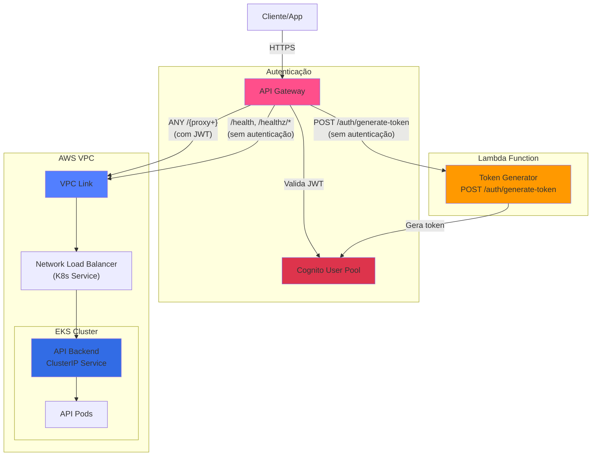

# Mecânica Hermes - API Gateway Infrastructure

Este módulo Terraform gerencia o AWS API Gateway que atua como ponto de entrada unificado para a aplicação Mecânica Hermes, integrando autenticação via Cognito, função Lambda para geração de tokens e o backend da API no EKS.

---

## Tecnologias Utilizadas


- **Terraform** para provisionamento de infraestrutura como código (IaC)
- **AWS API Gateway (HTTP API)** como ponto de entrada unificado
- **AWS Cognito** para autenticação JWT
- **VPC Link** para integração privada com o backend EKS
- **Lambda Integration** para endpoint de geração de tokens
- **CloudWatch Logs** para observabilidade

---

## Arquitetura



---

## Recursos Gerenciados

### API Gateway

- **HTTP API**: API Gateway com suporte a CORS
- **Cognito Authorizer**: Autenticador JWT usando Cognito User Pool
- **CloudWatch Logs**: Logs de acesso e execução

### Integrações

#### 1. Lambda Integration

- **Endpoint**: `POST /auth/generate-token`
- **Autenticação**: Nenhuma (público)
- **Função**: Gera tokens de acesso via Cognito para clientes autenticados

#### 2. VPC Link Integration

- **Endpoint**: `ANY /{proxy+}`
- **Autenticação**: JWT obrigatório
- **Função**: Proxy reverso para o backend da API no EKS
- **Health Checks**: `/health`, `/healthz/live`, `/healthz/ready` (sem autenticação)

### VPC Link

- **Security Group**: Permite comunicação com o NLB
- **Subnets**: Subnets privadas da VPC

---

## Estrutura de Diretórios

```text
api-gateway/
├── modules/
│   └── api-gateway/
│       ├── api_gateway.tf        # API Gateway e Stage
│       ├── authorizer.tf         # Cognito Authorizer
│       ├── data.tf               # Data sources
│       ├── integrations.tf       # Lambda e VPC Link integrations
│       ├── outputs.tf            # Outputs do módulo
│       ├── routes.tf             # Rotas do API Gateway
│       ├── variables.tf          # Variáveis do módulo
│       └── vpc_link.tf           # VPC Link e Security Group
├── backend-hml.hcl               # Configuração de backend para HML
├── backend-prd.hcl               # Configuração de backend para PRD
├── backend.tf                    # Definição do backend S3
├── hml.tfvars                    # Variáveis para HML
├── hml.tfvars.example            # Exemplo de variáveis para HML
├── main.tf                       # Invocação do módulo
├── outputs.tf                    # Outputs raiz
├── prd.tfvars                    # Variáveis para PRD
├── prd.tfvars.example            # Exemplo de variáveis para PRD
├── provider.tf                   # Provider AWS
└── variables.tf                  # Variáveis raiz
```

---

## Fluxo de Requisições

### 1. Geração de Token (Sem Autenticação)

```
Cliente -> API Gateway -> Lambda -> Cognito
       <- Token JWT <---------<-
```

### 2. Acesso à API (Com Autenticação JWT)

```
Cliente -> API Gateway -> Valida JWT (Cognito) -> VPC Link -> NLB -> API Backend
       <- Resposta <--------<---------<---------<------<-----
```

### 3. Health Checks (Sem Autenticação)

```
Cliente/Monitor -> API Gateway -> VPC Link -> NLB -> API Backend -> /health
               <- Status <------<---------<------<------------<-
```

---

## Rotas Configuradas

| Rota | Método | Autenticação | Destino | Descrição |
|------|--------|-------------|---------|-----------|
| `/auth/generate-token` | POST | ❌ Não | Lambda | Gera token de acesso Cognito |
| `/{proxy+}` | ANY | ✅ JWT | API Backend | Todas as rotas da API |
| `/health` | GET | ❌ Não | API Backend | Health check |
| `/healthz/live` | GET | ❌ Não | API Backend | Liveness probe |
| `/healthz/ready` | GET | ❌ Não | API Backend | Readiness probe |

---

## Pré-requisitos

Antes de executar este módulo, certifique-se de que os seguintes recursos já existem:

1. **VPC e Subnets** (criados pelo módulo `aws/`)
2. **EKS Cluster** (criado pelo módulo `aws/`)
3. **Cognito User Pool** (criado pelo módulo `cognito/`)
4. **Lambda Function** (criada pelo repositório `mecanica-hermes-lambda`)
5. **API Backend** deployado no K8s com serviço NLB (criado pelo repositório `mecanica-hermes-k8s`)

---

## Descoberta Automática de Recursos

O módulo utiliza **data sources** para descobrir automaticamente:

- ✅ VPC ID
- ✅ Subnets privadas
- ✅ EKS Cluster
- ✅ Network Load Balancer (criado pelo serviço K8s)

**Você só precisa fornecer:**

- ARN do Cognito User Pool
- ARN e nome da função Lambda

---

## Execução pela Pipeline

### Secrets Necessárias

Configure as seguintes secrets no GitHub (environments `api-gateway-hml` e `api-gateway-prd`):

| Variável | Descrição |
|----------|-----------|
| `AWS_ACCESS_KEY_ID` | Chave de acesso da AWS |
| `AWS_SECRET_ACCESS_KEY` | Chave secreta da AWS |
| `AWS_SESSION_TOKEN` | Token de sessão da AWS |

### Variables de Ambiente

| Variável (HML) | Variável (PRD) | Descrição |
|----------------|----------------|-----------|
| `HML_COGNITO_USER_POOL_ARN` | `PRD_COGNITO_USER_POOL_ARN` | ARN do User Pool do Cognito |
| `HML_LAMBDA_FUNCTION_ARN` | `PRD_LAMBDA_FUNCTION_ARN` | ARN da função Lambda |
| `HML_LAMBDA_FUNCTION_NAME` | `PRD_LAMBDA_FUNCTION_NAME` | Nome da função Lambda |
| `HML_VPC_ID` | `PRD_VPC_ID` | ID da VPC |
| `HML_PRIVATE_SUBNETS` | `PRD_PRIVATE_SUBNETS` | IDs das subnets privadas (separadas por vírgula) |
| `HML_API_BACKEND_SG_ID` | `PRD_API_BACKEND_SG_ID` | ID do Security Group do backend |

### Deploy

Dispare a Action manual de acordo com o seu ambiente:

- **HML:** `API Gateway HML - Terraform Create`
- **PRD:** `API Gateway PRD - Terraform Create`

### Destroy

Dispare a Action manual de acordo com o seu ambiente:

- **HML:** `API Gateway HML - Terraform Destroy`
- **PRD:** `API Gateway PRD - Terraform Destroy`

---

## Execução Local

### 1. Configurar AWS Credentials

```bash
aws configure
```

### 2. Inicializar Terraform

**Para HML:**

```bash
cd api-gateway
terraform init -backend-config=backend-hml.hcl
```

**Para PRD:**

```bash
cd api-gateway
terraform init -backend-config=backend-prd.hcl
```

### 3. Descobrir Valores de Recursos

Execute os seguintes comandos para descobrir os valores necessários:

**VPC ID:**

```bash
aws ec2 describe-vpcs --filters "Name=tag:Name,Values=mechermes-vpc" --query "Vpcs[0].VpcId" --output text
```

**Subnets Privadas:**

```bash
aws ec2 describe-subnets --filters "Name=tag:Name,Values=mechermes-vpc-private-*" --query "Subnets[*].SubnetId" --output text
```

**Cognito User Pool ARN:**

```bash
aws cognito-idp list-user-pools --max-results 60 --query "UserPools[?Name=='mechermes-hml-userpool'].Arn | [0]" --output text
```

**Lambda Function ARN:**

```bash
aws lambda get-function --function-name mechermes-hml-cognito-token-lambda --query "Configuration.FunctionArn" --output text
```

**Security Group do Backend:**

```bash
aws ec2 describe-security-groups --filters "Name=tag:Name,Values=mechermes-sg" --query "SecurityGroups[0].GroupId" --output text
```

### 4. Criar arquivo de variáveis

Copie o exemplo e preencha com os valores descobertos:

```bash
cp hml.tfvars.example hml.tfvars
# Edite hml.tfvars com os valores reais
```

### 5. Planejar e Aplicar

**Planejar:**

```bash
terraform plan -var-file=hml.tfvars
```

**Aplicar:**

```bash
terraform apply -var-file=hml.tfvars
```

### 6. Obter URL do API Gateway

```bash
terraform output stage_invoke_url
```

---

## Testando o API Gateway

### 1. Gerar Token de Acesso

```bash
API_GATEWAY_URL="<sua-url-do-api-gateway>"

# Gerar token
TOKEN_RESPONSE=$(curl -X POST "$API_GATEWAY_URL/auth/generate-token" \
  -H "Content-Type: application/json" \
  -d '{"cpf": "51125363061"}')

# Extrair token
ACCESS_TOKEN=$(echo $TOKEN_RESPONSE | jq -r '.accessToken')
```

### 2. Acessar API Backend

```bash
# Fazer requisição autenticada
curl "$API_GATEWAY_URL/api/v1/ordens-de-servico" \
  -H "Authorization: Bearer $ACCESS_TOKEN"
```

### 3. Health Checks

```bash
# Health check geral
curl "$API_GATEWAY_URL/health"

# Liveness probe
curl "$API_GATEWAY_URL/healthz/live"

# Readiness probe
curl "$API_GATEWAY_URL/healthz/ready"
```

---

## Observabilidade

### CloudWatch Logs

Os logs do API Gateway são armazenados em:

```
/aws/apigateway/mechermes-hml
/aws/apigateway/mechermes-prd
```

### Métricas Importantes

- **4xx Errors**: Erros de cliente (autenticação inválida, etc.)
- **5xx Errors**: Erros de servidor (backend indisponível, etc.)
- **Latency**: Latência de requisições
- **Count**: Total de requisições

---

## Troubleshooting

### Erro: "Unauthorized"

**Causa**: Token JWT inválido ou expirado

**Solução**: Gere um novo token via `POST /auth/generate-token`

### Erro: "VPC Link not available"

**Causa**: VPC Link ainda está sendo criado

**Solução**: Aguarde alguns minutos. VPC Links podem levar até 10 minutos para ficarem disponíveis.

### Erro: "Integration timed out"

**Causa**: Backend não está respondendo

**Solução**:

1. Verifique se os pods estão rodando: `kubectl get pods -n mecanica-hermes-hml`
2. Verifique se o NLB está healthy
3. Verifique os security groups

---

## Integração com New Relic

O API Gateway **NÃO afeta** as configurações do New Relic:

- ✅ Os pods continuam enviando telemetria diretamente para o New Relic
- ✅ O New Relic Infrastructure Agent continua funcionando
- ✅ Todas as configurações OTEL permanecem inalteradas

O API Gateway atua apenas como um proxy reverso, não interceptando ou modificando a telemetria da aplicação.

---

## Migração do Load Balancer

### Antes (LoadBalancer Service)

```
Cliente -> ALB (Internet-facing) -> Service (LoadBalancer) -> Pods
```

### Depois (API Gateway + VPC Link)

```
Cliente -> API Gateway -> Cognito (Auth) -> VPC Link -> NLB -> Service (LoadBalancer) -> Pods
```

**Nota**: O serviço K8s permanece como `LoadBalancer` para que o AWS crie automaticamente o NLB. O API Gateway se conecta ao NLB via VPC Link.

---

## Segurança

### Autenticação

- ✅ JWT obrigatório para todas as rotas da API (exceto health checks)
- ✅ Tokens validados automaticamente pelo Cognito Authorizer

### Rede

- ✅ VPC Link para comunicação privada
- ✅ Security Groups controlando acesso
- ✅ Backend em subnets privadas

### Logs e Auditoria

- ✅ Todos os acessos logados no CloudWatch
- ✅ Rastreamento de requests com `requestId`

---

## Custos Estimados

| Recurso | Custo Mensal (estimado) |
|---------|------------------------|
| API Gateway HTTP API | $1.00/milhão de requisições |
| VPC Link | ~$22/mês por VPC Link |
| CloudWatch Logs | ~$0.50/GB ingerido |
| **Total estimado (1M req/mês)** | **~$25-30/mês** |

---

## Próximos Passos

1. ✅ Deploy do API Gateway via GitHub Actions
2. ✅ Configurar DNS customizado (opcional)
3. ✅ Configurar WAF (opcional, para proteção adicional)
4. ✅ Configurar custom domain e certificado SSL (opcional)
5. ✅ Configurar throttling e rate limiting por rota (opcional)

---

## Referências

- [AWS API Gateway HTTP APIs](https://docs.aws.amazon.com/apigateway/latest/developerguide/http-api.html)
- [VPC Links for HTTP APIs](https://docs.aws.amazon.com/apigateway/latest/developerguide/http-api-vpc-links.html)
- [JWT Authorizers](https://docs.aws.amazon.com/apigateway/latest/developerguide/http-api-jwt-authorizer.html)
- [Terraform AWS API Gateway v2](https://registry.terraform.io/providers/hashicorp/aws/latest/docs/resources/apigatewayv2_api)
