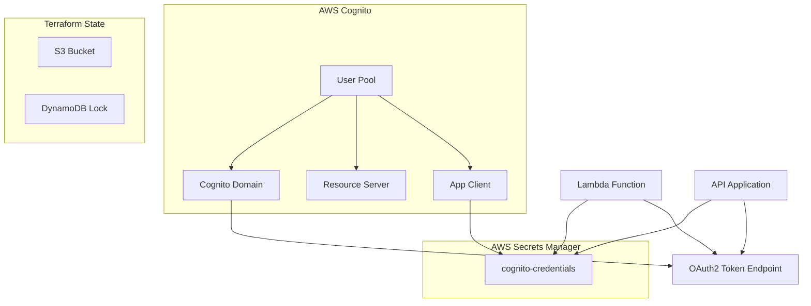

# Mecânica Hermes - Cognito Infrastructure

Este módulo Terraform gerencia a infraestrutura do AWS Cognito para autenticação e autorização da aplicação Mecânica Hermes.

---

## Tecnologias Utilizadas


- **Terraform** para provisionamento de infraestrutura como código (IaC)
- **AWS Cognito** para autenticação e autorização OAuth2
- **AWS Secrets Manager** para armazenamento seguro de credenciais
- **S3** para armazenamento do estado do Terraform
- **DynamoDB** para lock de estado do Terraform

---

## Recursos Gerenciados

Este módulo provisiona e gerencia os seguintes recursos do Cognito:

- **User Pool**: Pool de usuários do Cognito
- **User Pool Client**: Cliente de aplicação com suporte a `client_credentials` flow
- **Resource Server**: Servidor de recursos com scopes customizados
- **Domain**: Domínio Cognito para endpoints OAuth2
- **Secrets Manager**: Armazenamento seguro do `client_secret` e outras credenciais

### Scopes Customizados

O módulo configura dois scopes:

- `mechermes/admin`: Acesso administrativo
- `mechermes/client`: Acesso de cliente

---

## Arquitetura



---

## Estrutura de Diretórios

```text
cognito/
├── modules/
│   └── cognito/
│       ├── domain.tf              # Cognito Domain
│       ├── outputs.tf             # Outputs do módulo
│       ├── resource_server.tf     # Resource Server com scopes
│       ├── secrets.tf             # AWS Secrets Manager
│       ├── user_pool.tf           # User Pool
│       ├── user_pool_client.tf    # App Client
│       └── variables.tf           # Variáveis do módulo
├── backend-hml.hcl                # Configuração de backend para HML
├── backend-prd.hcl                # Configuração de backend para PRD
├── backend.tf                     # Definição do backend S3
├── hml.tfvars.example             # Exemplo de variáveis para HML
├── main.tf                        # Invocação do módulo
├── outputs.tf                     # Outputs raiz
├── prd.tfvars.example             # Exemplo de variáveis para PRD
├── provider.tf                    # Provider AWS
├── terraform.tfvars.example       # Exemplo de variáveis genérico
└── variables.tf                   # Variáveis raiz
```

---

## Pré-requisitos

### 1. Credenciais AWS

Configure suas credenciais AWS:

```bash
aws configure
```

### 2. Backend do Terraform

Certifique-se de que o bucket S3 e a tabela DynamoDB existem:

```bash
# Criar bucket S3 (se não existir)
aws s3api create-bucket --bucket mechermes-tf-state-aws --region us-east-1

# Criar tabela DynamoDB (se não existir)
aws dynamodb create-table \
  --table-name mechermes-tf-locks \
  --attribute-definitions AttributeName=LockID,AttributeType=S \
  --key-schema AttributeName=LockID,KeyType=HASH \
  --provisioned-throughput ReadCapacityUnits=5,WriteCapacityUnits=5 \
  --region us-east-1
```

---

## Configuração Inicial

### 1. Obter Informações do Cognito Existente

Antes de importar, você precisa obter as informações do Cognito configurado manualmente.

#### Listar User Pools

```bash
aws cognito-idp list-user-pools --max-results 20
```

Anote o `Id` e o `Name` do User Pool.

#### Obter Detalhes do User Pool

```bash
aws cognito-idp describe-user-pool --user-pool-id <USER_POOL_ID>
```

#### Listar Resource Servers

```bash
aws cognito-idp list-resource-servers --user-pool-id <USER_POOL_ID>
```

#### Listar User Pool Clients

```bash
aws cognito-idp list-user-pool-clients --user-pool-id <USER_POOL_ID>
```

#### Obter Domínio Cognito

```bash
aws cognito-idp describe-user-pool-domain --domain <DOMAIN_PREFIX>
```

### 2. Criar Arquivo de Variáveis

Copie o arquivo de exemplo e preencha com os valores do seu ambiente:

```bash
# Para HML
cp hml.tfvars.example hml.tfvars

# Para PRD
cp prd.tfvars.example prd.tfvars
```

Edite o arquivo `hml.tfvars` ou `prd.tfvars` substituindo os placeholders:

```hcl
environment           = "hml"  # ou "prd"
cognito_domain_prefix = "mechermes-hml"  # Use o valor real
user_pool_name        = "mechermes-hml-userpool"  # Use o valor real
```

---

## Importação de Recursos Existentes

**IMPORTANTE**: Para evitar a destruição dos recursos existentes, você deve importá-los para o estado do Terraform antes de executar `terraform apply`.

### 1. Inicializar Terraform

```bash
# Para HML
terraform init -backend-config=backend-hml.hcl

# Para PRD
terraform init -backend-config=backend-prd.hcl
```

### 2. Executar Terraform Plan (sem aplicar)

```bash
# Para HML
terraform plan -var-file=hml.tfvars

# Para PRD
terraform plan -var-file=prd.tfvars
```

Você verá que o Terraform quer criar todos os recursos. Isso é esperado antes da importação.

### 3. Importar Recursos

Execute os comandos de importação abaixo, substituindo os valores pelos IDs reais:

#### a) Importar User Pool

```bash
terraform import -var-file=hml.tfvars \
  module.cognito.aws_cognito_user_pool.main \
  <USER_POOL_ID>
```

**Exemplo**:


```bash
terraform import -var-file=hml.tfvars \
  module.cognito.aws_cognito_user_pool.main \
  us-east-1_ABC123DEF
```

#### b) Importar Resource Server

```bash
terraform import -var-file=hml.tfvars \
  module.cognito.aws_cognito_resource_server.main \
  <USER_POOL_ID>|<RESOURCE_SERVER_IDENTIFIER>
```

**Exemplo**:


```bash
terraform import -var-file=hml.tfvars \
  module.cognito.aws_cognito_resource_server.main \
  us-east-1_ABC123DEF|mechermes
```

#### c) Importar User Pool Client

```bash
terraform import -var-file=hml.tfvars \
  module.cognito.aws_cognito_user_pool_client.main \
  <USER_POOL_ID>/<CLIENT_ID>
```

**Exemplo**:


```bash
terraform import -var-file=hml.tfvars \
  module.cognito.aws_cognito_user_pool_client.main \
  us-east-1_ABC123DEF/1a2b3c4d5e6f7g8h9i0j
```

#### d) Importar Cognito Domain

```bash
terraform import -var-file=hml.tfvars \
  module.cognito.aws_cognito_user_pool_domain.main \
  <COGNITO_DOMAIN_PREFIX>
```

**Exemplo**:


```bash
terraform import -var-file=hml.tfvars \
  module.cognito.aws_cognito_user_pool_domain.main \
  mechermes-hml
```

#### e) Criar Secret no Secrets Manager (não precisa importar)

O secret será criado pelo Terraform. Se já existir um secret com credenciais, você pode:

- Renomear o secret existente
- Ou importá-lo:

```bash
terraform import -var-file=hml.tfvars \
  module.cognito.aws_secretsmanager_secret.cognito_credentials \
  <SECRET_ARN>
```

### 4. Verificar Importação

Após importar todos os recursos, execute novamente o plan:

```bash
terraform plan -var-file=hml.tfvars
```

**Resultado esperado**: O Terraform deve mostrar que não há mudanças a serem feitas, ou apenas mudanças pequenas (como tags ou descrições). **NÃO deve mostrar destruição e recriação de recursos**.

---

## Execução

### Aplicar Configuração

Após a importação bem-sucedida:

```bash
# Para HML
terraform apply -var-file=hml.tfvars

# Para PRD
terraform apply -var-file=prd.tfvars
```

### Validação

```bash
# Formatar código
terraform fmt -recursive

# Validar sintaxe
terraform validate

# Ver plano de execução
terraform plan -var-file=hml.tfvars
```

---

## Deploy via GitHub Actions

Este módulo pode ser implantado automaticamente através de GitHub Actions workflows.

### Workflows Disponíveis

O projeto possui 4 workflows configurados:

- **Cognito HML - Terraform Create**: Cria/atualiza infraestrutura Cognito no ambiente HML
- **Cognito PRD - Terraform Create**: Cria/atualiza infraestrutura Cognito no ambiente PRD
- **Cognito HML - Terraform Destroy**: Destrói infraestrutura Cognito no ambiente HML
- **Cognito PRD - Terraform Destroy**: Destrói infraestrutura Cognito no ambiente PRD

### Configuração de Secrets e Variáveis

Configure os seguintes secrets/variáveis no GitHub:

#### Secrets Comuns (ambos ambientes)

| Secret | Descrição |
| ------ | --------- |
| `AWS_ACCESS_KEY_ID` | AWS Access Key ID |
| `AWS_SECRET_ACCESS_KEY` | AWS Secret Access Key |
| `AWS_SESSION_TOKEN` | AWS Session Token (se aplicável) |

#### Secrets Específicos do HML

Configure no environment `cognito-hml`:

| Secret | Descrição | Exemplo |
| ------ | --------- | ------- |
| `HML_USER_POOL_ID` | ID do User Pool HML | `us-east-1_ABC123DEF` |
| `HML_RESOURCE_SERVER_IDENTIFIER` | Identificador do Resource Server | `mechermes` |
| `HML_CLIENT_ID` | ID do App Client | `1a2b3c4d5e6f7g8h9i0j` |
| `HML_DOMAIN_PREFIX` | Prefixo do domínio Cognito | `mechermes-hml` |

#### Secrets Específicos do PRD

Configure no environment `cognito-prd`:

| Secret | Descrição | Exemplo |
| ------ | --------- | ------- |
| `PRD_USER_POOL_ID` | ID do User Pool PRD | `us-east-1_XYZ789ABC` |
| `PRD_RESOURCE_SERVER_IDENTIFIER` | Identificador do Resource Server | `mechermes` |
| `PRD_CLIENT_ID` | ID do App Client | `9i8h7g6f5e4d3c2b1a0` |
| `PRD_DOMAIN_PREFIX` | Prefixo do domínio Cognito | `mechermes-prd` |

#### Variáveis

| Variável | Descrição | Valor Padrão |
| -------- | --------- | ------------ |
| `AWS_DEFAULT_REGION` | Região AWS | `us-east-1` |

### Arquivos de Variáveis

Certifique-se de criar os arquivos de variáveis antes de executar os workflows:

```bash
# Criar hml.tfvars no repositório
cp hml.tfvars.example hml.tfvars
# Editar com valores reais e fazer commit

# Criar prd.tfvars no repositório
cp prd.tfvars.example prd.tfvars
# Editar com valores reais e fazer commit
```

**IMPORTANTE**: Os arquivos `.tfvars` reais devem ser commitados no repositório para que os workflows funcionem. O `.gitignore` já está configurado para permitir arquivos `hml.tfvars` e `prd.tfvars`.

### Executando Workflows

1. Navegue até **Actions** no repositório GitHub
2. Selecione o workflow desejado (ex: "Cognito HML - Terraform Create")
3. Clique em **Run workflow**
4. Selecione a branch (geralmente `main`)
5. Clique em **Run workflow** novamente

### Ordem de Execução Recomendada

#### Primeira Implantação (com recursos existentes)

1. **Preparação Local**:
   - Configure os arquivos `hml.tfvars` e `prd.tfvars`
   - Execute importação local dos recursos existentes
   - Verifique com `terraform plan` que não há destruição
   - Faça commit dos arquivos `.tfvars`

2. **Deploy via GitHub Actions**:
   - Execute workflow "Cognito HML - Terraform Create"
   - Verifique os logs para garantir sucesso
   - Execute workflow "Cognito PRD - Terraform Create"

#### Atualizações Subsequentes

Após a primeira implantação, você pode usar os workflows diretamente para aplicar mudanças:

1. Edite os arquivos Terraform conforme necessário
2. Faça commit e push para o repositório
3. Execute o workflow correspondente ao ambiente desejado

### Vantagens do GitHub Actions

- ✅ **Infraestrutura centralizada**: Não depende de ambiente local
- ✅ **Auditoria**: Todas as execuções ficam registradas
- ✅ **Segurança**: Secrets gerenciados pelo GitHub
- ✅ **Automação**: Backend S3/DynamoDB criado automaticamente se necessário
- ✅ **Consistência**: Mesma versão do Terraform em todas as execuções

---

## Outputs

Após o apply, o Terraform fornecerá os seguintes outputs (não sensíveis):

| Output | Descrição |
| ------ | --------- |
| `cognito_user_pool_id` | ID do User Pool |
| `cognito_user_pool_arn` | ARN do User Pool |
| `cognito_client_id` | ID do App Client |
| `cognito_domain` | Prefixo do domínio Cognito |
| `cognito_token_endpoint` | URL do endpoint OAuth2 token |
| `cognito_scopes` | Lista de scopes disponíveis |
| `cognito_secret_arn` | ARN do secret no Secrets Manager |
| `cognito_secret_name` | Nome do secret no Secrets Manager |

### Visualizar Outputs

```bash
terraform output
```

---

## Consumo por Aplicações

### Lambda Function

A Lambda deve:

1. Obter o ARN do secret via variável de ambiente ou output do Terraform
2. Usar AWS SDK para ler o secret do Secrets Manager
3. Extrair `client_id` e `client_secret` do JSON
4. Fazer requisição POST para o `token_endpoint` com `grant_type=client_credentials`

**Variáveis de ambiente sugeridas**:

```bash
COGNITO_SECRET_ID=mechermes-hml-cognito-credentials
COGNITO_TOKEN_ENDPOINT=https://mechermes-hml.auth.us-east-1.amazoncognito.com/oauth2/token
```

### API Application

Similar à Lambda, a API pode:

1. Ler configuração do Cognito via variáveis de ambiente
2. Validar tokens JWT recebidos usando o `user_pool_id`

---

## Gestão de Secrets

### Visualizar Secret

```bash
aws secretsmanager get-secret-value \
  --secret-id mechermes-hml-cognito-credentials \
  --query SecretString \
  --output text | jq
```

### Rotação Manual (se necessário)

Se precisar rotacionar o `client_secret`:

1. Gere um novo secret no Cognito Console
2. Atualize o secret no Secrets Manager
3. Reinicie aplicações que usam o secret

---

## Segurança

- **client_secret** nunca é exposto em outputs do Terraform
- Credenciais são armazenadas no AWS Secrets Manager com criptografia
- Recovery window de 7 dias para secrets deletados
- User Pool configurado com `prevent_destroy` para evitar destruição acidental
- Todos os recursos são tagueados para auditoria

---

## Troubleshooting

### Erro: Resource already exists

Se você receber um erro dizendo que o recurso já existe, execute a importação correspondente conforme documentado acima.

### Erro: Domain already exists

O domínio Cognito é globalmente único. Certifique-se de usar o mesmo prefixo do domínio existente.

### Erro: Client secret not accessible

Verifique as permissões IAM da aplicação consumidora. Ela precisa de:

```json
{
  "Effect": "Allow",
  "Action": [
    "secretsmanager:GetSecretValue",
    "secretsmanager:DescribeSecret"
  ],
  "Resource": "arn:aws:secretsmanager:us-east-1:*:secret:mechermes-*-cognito-credentials-*"
}
```

### Terraform plan mostra recriação de recursos

Se após a importação o Terraform ainda quer recriar recursos, compare os atributos:

```bash
terraform show
```

Compare com os valores reais no AWS Console. Ajuste as variáveis conforme necessário.

---

## Manutenção

### Adicionar novo scope

1. Edite `modules/cognito/resource_server.tf`
2. Adicione um novo bloco `scope`
3. Atualize `user_pool_client.tf` para incluir o novo scope em `allowed_oauth_scopes`
4. Execute `terraform apply`

### Adicionar novo ambiente

1. Crie `backend-{env}.hcl` com a configuração do backend
2. Crie `{env}.tfvars` com as variáveis do ambiente
3. Siga os passos de importação para o novo ambiente

---

## Referências

- [AWS Cognito Terraform Provider](https://registry.terraform.io/providers/hashicorp/aws/latest/docs/resources/cognito_user_pool)
- [OAuth 2.0 Client Credentials Flow](https://oauth.net/2/grant-types/client-credentials/)
- [AWS Secrets Manager](https://docs.aws.amazon.com/secretsmanager/)

---

## Suporte

Em caso de problemas:

1. Verifique os logs do Terraform com `TF_LOG=DEBUG terraform apply`
2. Consulte a documentação do provider AWS
3. Verifique se as credenciais AWS têm as permissões necessárias
